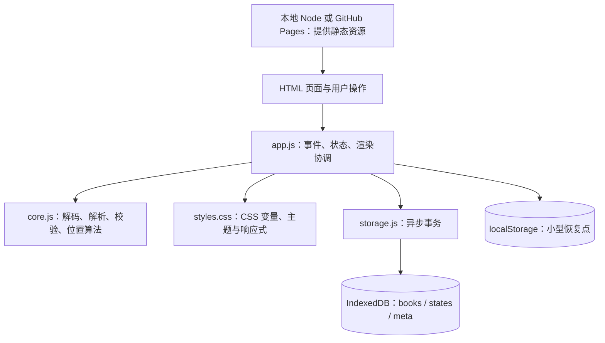

# 爱书文本阅读器：答辩讲解稿

> 整理日期：2026-10-17。根据当前源码编写，项目原名“拾页”，目前界面名称为“爱书”。
>
> 使用方法：先演示约 5 分钟，再讲解约 10 分钟。“操作提示”不用朗读；最后的补充问答供追问时查阅。时间取决于语速，建议先计时练习。
>
> 本项目使用了 AI 辅助开发。讲稿里的实现说明可以学习后使用；个人完成的工作与理解程度请按实际情况表述。

## 一、约 5 分钟功能演示稿

### 0:00—0:30：介绍项目

各位好，我展示的是一个叫“爱书”的浏览器文本阅读器。它围绕三个目标设计：能方便地导入文字，能按照个人习惯阅读，也能在下次打开时继续阅读。

它已经实现考核要求的文本导入、书架增删选择、字号调整、背景调整、护眼模式和阅读进度保存，并加入目录、书签、专注模式及备份恢复。

【操作提示】打开公网网站，或先执行 `npm start`，访问 `http://localhost:5173`。演示前备份自己的书架，用项目的演示文本操作。

### 0:30—1:20：导入与书架

我先导入一个 TXT 文件。这个操作是在浏览器里读取文件，不会把正文上传到服务器。也可以直接拖入文件，或者粘贴一段文本并填写书名。

导入后，书籍出现在左侧书架。点击不同书籍，可以切换正文。书架支持按书名搜索，以及按最近阅读、最近添加和书名排序。

我再导入一次相同文本。程序按正文内容去重，所以即使文件改名，也不会生成两份相同的书。删除书籍时会先确认，确认后删除的是阅读器里的记录，原始文件不会被删除。

【操作提示】使用 `samples/导入演示.txt`；粘贴新增一份临时笔记；演示一次取消删除，再删除临时笔记。

### 1:20—2:20：阅读设置

接下来展示阅读设置。字号可以在 14 到 36 像素之间调整，行间距可以在 1.4 到 2.6 倍之间调整，也可以切换宋体和黑体。

我先滚动到中段，再调整字号。可以看到，程序会尽量保留当前段落的位置。背景提供纸白、暖砂、青苔和夜读，也支持自定义颜色。

护眼模式是独立开关。开启后使用柔和的绿色背景，关闭后回到之前选择的主题。这里的护眼是配色功能，不代表医学上的保护效果。

【操作提示】先选暖砂，再开关护眼，证明能够回到暖砂；恢复适合演示的字号。

### 2:20—3:20：进度、目录和书签

阅读位置会自动保存。我在中间添加一个书签，然后使用目录跳到另一章，再点击书签回到原来的位置。

现在切换到另外一本书，再切回来。接着刷新页面，可以看到书籍、阅读位置、书签和设置都能恢复。

目录是从文本标题中识别出来的，例如“第一章”、英文 Chapter，以及 Markdown 的一级到三级标题。不能识别所有随意排版的标题，没有目录的书仍然可以正常阅读。

【操作提示】使用《林间漫步》演示章节；等待右上角显示“已自动保存”再刷新。

### 3:20—4:10：专注与移动布局

按 F 可以进入专注模式，隐藏书架和设置，把主要空间留给正文。按 Esc 退出，按 B 添加书签，PageUp 和 PageDown 可以滚动翻阅。

缩窄窗口后，书架和设置会改为可打开的面板。长书名也会单行省略，避免占用过多正文空间。

【操作提示】输入框中打字时快捷键不会触发，演示前先把焦点移出输入框。

### 4:10—5:00：备份与数据边界

最后展示备份。导出的 JSON 包含正文、进度、书签和设置。在另一个浏览器或设备上，可以通过恢复文件迁移书架。

公网部署的是阅读器程序，书架数据仍然保存在用户自己的浏览器里，因此不同设备不会自动同步。清理网站数据也可能删除书架，所以提供备份功能很有必要。

以上是功能演示，接下来我介绍架构、实现过程和选型理由。

## 二、约 10 分钟正式讲解稿

### 0:00—1:15：整体架构

这个项目采用原生 HTML、CSS 和 JavaScript，使用 ES Modules 拆分代码。整体是一个静态前端应用，文件处理、阅读设置和数据存储都在浏览器端完成。

我按职责把项目分成几个部分。`index.html` 提供书架、正文、设置和弹窗的结构；`styles.css` 控制布局、配色和响应式；`app.js` 连接用户操作、内存状态、页面渲染和存储；`core.js` 提供不依赖页面的文本处理和位置算法；`storage.js` 专门访问 IndexedDB；`sample.js` 保存内置演示文本。

本地的 `server.mjs` 使用 Node.js 内置 HTTP 模块提供静态文件。它不负责保存书架，也不是接收正文的业务后端。公网使用 GitHub Pages 提供这些静态资源，因此不需要常驻的 Node 服务。

选择这种架构，是因为项目的核心需求是本地文本阅读和状态保存，浏览器已经具备所需能力。原生方案没有第三方依赖和构建过程，现场启动、定位问题和修改代码都比较直接。代价是页面继续扩大后，需要进一步拆分 `app.js`，减少一个文件承担的职责。

【操作提示】展示项目目录，只强调每个文件的职责，不逐行读代码。

### 1:15—2:15：状态管理与数据流

程序用一个 `state` 对象保存当前页面的主要状态。`books` 是以正文摘要为键的 Map，`currentId` 表示当前书，`settings` 保存全局阅读偏好。`parsed` 是当前书解析后的段落与目录，`tops` 是各段落在滚动区域里的坐标。

一次典型操作是：用户拖动字号滑块，事件回调读取值，`changeSettings` 校验并修改内存设置，然后 `renderSettings` 更新控件和 CSS 变量，最后恢复阅读位置并安排保存。

这里用 Map 是为了按书籍 id 直接查找。目录和段落坐标属于可以重新计算的数据，所以不作为永久数据保存。这样可以避免旧的布局坐标在换设备、换字号后失效。

我没有引入额外的状态管理库，是因为目前是单页面、单用户的交互规模，集中状态配合明确的函数已经足够。以后功能增加，可以将书架、设置和阅读控制进一步拆成模块。

### 2:15—3:30：文本导入、解析与书架

导入流程从 File API 开始，浏览器将文件读取为 ArrayBuffer，再通过 TextDecoder 按编码转成字符串。自动模式先处理带字节序标记的 UTF-16，再尝试严格 UTF-8，失败后尝试 GB18030。用户也可以手动指定编码。

解码后，程序去掉开头的 BOM、统一换行、移除 NUL 字符，再检查空内容、文本大小和非空段落数量。自动解码不是万能识别，不支持的编码仍可能需要用户转换。

随后用 Web Crypto 的 SHA-256 对规范化后的正文计算摘要，作为书籍 id。同内容即使文件名不同，也会得到同一个 id，保留原书与原进度。这是内容去重，不是加密正文。

解析时，把每个非空行作为一个阅读块，用正则识别常见章节标题；章节渲染为 h2，其他正文渲染为 p。渲染时通过 `textContent` 放入文字，文件中的 HTML 和脚本不会被当成代码执行。Markdown 也按文本处理，只识别部分标题。

新增书籍时，先等待数据库写入成功，再更新内存书架和页面。搜索按书名包含关系过滤，排序按时间或书名比较；删除经过确认后，同时删掉正文和阅读状态。

这些选择让实现比较清楚，也适合 TXT 阅读需求。代价是章节识别依赖格式，而且当前没有支持 PDF、EPUB 或完整 Markdown 排版。

### 3:30—5:00：本地持久化

数据存储使用 IndexedDB，分成三个 object store，也就是三类数据集合。`books` 保存正文、书名和加入时间；`states` 保存位置、书签、最后阅读时间和累计阅读秒数；`meta` 保存当前书、全局设置和初始化标记。

正文较大，而且导入后通常不变。阅读状态较小，但会频繁变化，所以两类数据分开存，滚动时不必重写整本书。

我选择 IndexedDB，是因为它支持异步读写、结构化数据和事务，比把整本正文频繁写入同步的 localStorage 更适合这个场景。不过它仍受浏览器配额和网站来源隔离限制，不是无限空间，也不是云数据库。

滚动事件先通过 requestAnimationFrame 合并页面更新，再用 250 毫秒防抖安排保存。防抖的意思是连续操作时取消之前的定时任务，在暂时停下后保存。切换书籍前会先发起旧书的保存；写入通过 Promise 队列按顺序执行。保存版本号用于避免旧任务完成时把新状态错误显示成已经保存。

另外，程序用 localStorage 保存一个很小的辅助恢复点，里面没有全文。页面隐藏或离开时会尝试同步保留当前位置，减少异步事务尚未完成造成的丢失窗口。这只是补充措施，不能承诺突然断电等情况下绝不丢失最后一步。

### 5:00—6:30：阅读位置恢复

阅读位置是这个项目比较需要解释的部分。只保存滚动像素，字号变大后同一个像素就可能对应另一段内容。只保存百分比，也不能保证内容位置完全稳定。

因此程序保存三项信息：段落索引 index、段落区间内的比例 fraction，以及整体滚动比例 progress。

举例来说，某段从 300 像素开始，下一段从 550 像素开始，用户滚动到 375，那么区间内比例就是 75 除以 250，等于 0.3。字号改变后，假设同一段和下一段分别变为 500 和 900，那么恢复位置就是 500 加上 400 乘以 0.3，也就是 620 像素。

程序缓存段落坐标，滚动时用二分查找确定当前位置属于哪个区间。字号、行距或窗口尺寸变化后，再测量一次坐标。requestAnimationFrame 让测量与布局更新配合，`restoring` 标记用于避免把程序恢复位置产生的滚动误当成用户操作。末尾和无效索引有专门的处理。

这种方式比只保存像素更适应重新排版，但它是段落区间的近似定位，不是精确到某一个字的定位。很长的一段文字内部，改变宽度以后仍可能存在偏差。

### 6:30—7:30：排版、主题与护眼

排版和主题主要通过 CSS 变量实现。JavaScript 将字号、行高、字体、背景和正文颜色写入变量，CSS 用这些变量显示正文，因此设置不需要分散修改很多节点。

数值在 `normalizeSettings` 中统一校验。例如字号限制在 14 到 36，行距限制在 1.4 到 2.6。页面滑块限制操作范围，JavaScript 校验还会处理从数据库或备份恢复的数值，两层各有用途。

护眼模式是一个单独的布尔值，开启时优先使用绿色主题，关闭后使用原本选择的主题。自定义背景使用相对亮度判断，选择深色或浅色正文，提高可读性；这不是对所有配色作无障碍认证。

桌面布局使用 CSS Grid 和 Flex。较窄窗口通过媒体查询改用抽屉面板。专注模式切换 body 上的 class，让 CSS 隐藏辅助区域。选择这些浏览器原生能力，可以在较少代码下完成布局变化。

### 7:30—8:30：扩展功能与公网部署

书签保存的是当前位置快照和一小段文字摘要，点击书签时复用位置恢复算法。目录也复用这套跳转逻辑，避免维护两套定位方式。

备份将书籍、阅读状态和设置序列化为 JSON，用 Blob 和临时下载链接生成文件。恢复时先校验格式、版本和大小，再重新计算内容摘要，按正文合并。相同内容采用较新的最后阅读时间选择状态，这属于简单的合并策略，不是逐个书签的冲突合并。

本次阅读时长在页面可见、窗口获得焦点且没有弹窗时累计；它不判断用户目光是否真的在阅读。剩余时间按每分钟 400 字估算，只是参考。

公网方面，GitHub 保存源码和版本记录，GitHub Pages 托管静态资源。VS Code 中的修改保存后，仍需提交和推送，Pages 部署完成后公网才会更新。网站上线不会让不同设备共享同一书架，数据仍在各自浏览器中。

### 8:30—9:30：验证与限制

验证分为核心逻辑测试和浏览器交互检查。核心逻辑通过 Node.js 内置测试工具检查文本解码、章节识别、内容摘要、位置算法、设置边界和备份校验。已有验证记录中也包括真实文件导入、书籍删除、刷新恢复、备份、移动布局等浏览器检查。

这些检查说明已覆盖的场景正常，不能据此说所有设备和任意大小文本都没有问题。当前单个文件最多 10 乘以 1024 乘以 1024 字节，规范化正文转为 UTF-8 后也受这一上限约束；每本最多四万个非空段落，书架最多两百本，单本最多一百个书签，备份文件最多六十 MB。

当前启动时会读取书架中的全部正文到内存，打开一本书会一次生成全部正文节点。因此大书架和很大的书仍可能占用较多内存。后续可以先只加载书籍元数据，选中时读取正文，再使用虚拟列表或分章加载；跨设备自动同步则需要额外的身份和服务端方案。

### 9:30—10:00：AI 使用与现场修改

开发过程中使用了 AI 辅助需求分析、代码、测试和文档生成。我会如实区分 AI 生成部分与自己实际修改、验证的内容。

本项目已经做过名称、图标和书名区域的调整。现场我可以进一步演示把行间距上限从 2.6 改为 3.0，同时修改页面滑块和 JavaScript 校验，运行后检查拖动与刷新恢复。这能够说明我理解了控件、状态、校验与保存之间的关系。

以上是我的架构、功能实现和选型分析，谢谢。

## 三、架构图与代码定位

| 功能 | 主要位置 / 搜索关键词 | 实现形式 |
| --- | --- | --- |
| 初始化与恢复 | `app.js`：`initialize` | 加载数据库，合并恢复点，渲染当前书 |
| 导入文本 | `app.js`：`importFiles`、`makeBook`；`core.js`：`decodeText` | File API + TextDecoder + 规范化与校验 |
| 去重 | `core.js`：`contentId`；`app.js`：`addBooks` | 正文 SHA-256 + Map |
| 书架选择与删除 | `selectBook`、`confirmDelete`、`renderShelf` | 当前 id 切换、确认弹窗、数据库删除 |
| 阅读设置 | `changeSettings`、`renderSettings`、`normalizeSettings` | 事件回调 → 校验 → 状态 → CSS 变量 |
| 进度保存 | `capturePosition`、`saveNow`、`scheduleSave` | 段落位置计算 + 防抖 + IndexedDB |
| 进度恢复 | `measureBlocks`、`restorePosition`、`scrollFromPosition` | 重新测量 DOM、恢复锚点、边界处理 |
| 目录 | `parseText`、`renderOutline` | 正则识别标题并保存块索引 |
| 书签 | `addBookmark`、`renderBookmarks` | 保存位置快照与摘要，复用恢复函数 |
| 备份恢复 | `exportBackup`、`restoreBackup`、`validateBackup` | JSON + Blob 下载 + 校验合并 |
| 专注和手机布局 | `setFocus`、CSS 媒体查询 | class 切换、Grid/Flex、侧栏抽屉 |

## 四、技术选型速查

| 选择 | 选它的原因 | 代价与适用范围 |
| --- | --- | --- |
| 原生 HTML/CSS/JS | 无安装依赖，运行直接，适合解释与小规模交互 | 功能扩张后需更细的模块划分 |
| ES Modules | import/export 分离职责，浏览器可直接使用 | 应通过 HTTP/HTTPS 访问 |
| Map 保存内存书架 | 按内容 id 查找方便 | 刷新后消失，需要数据库持久化 |
| IndexedDB | 异步、结构化记录、事务，适合正文和状态 | 配额有限，按来源隔离，无自动跨设备同步 |
| localStorage 辅助恢复点 | 小状态可同步写入，缩小离开页面时的风险窗口 | 同步 API，容量有限，不适合全文高频写入 |
| TextDecoder | 浏览器内置，无解码库依赖，支持所需常见编码 | 自动识别有限，可能需要手动选择 |
| SHA-256 | 根据正文内容去重，文件名变化不影响 | 需要读取全文；散列不是加密或权限控制 |
| textContent + p/h2 | 纯文本显示，避免导入 HTML 作为代码执行 | 不提供复杂富文本排版 |
| CSS 变量 + 媒体查询 | 排版集中控制，适配不同窗口 | 大布局调整需检查不同断点 |
| 段落索引与比例 | 比固定像素更适应字号和宽度变化 | 近似恢复，未达到精确字符定位 |
| 防抖 + 写入队列 | 减少频繁写库，按顺序写状态快照 | 保存有短暂延迟；多标签页冲突仍需改进 |
| Node 内置 HTTP | 本地零依赖启动 | 只做静态服务，不承担云同步业务 |
| GitHub Pages | 项目为静态资源，部署方便，不需管理业务服务器 | 无自定义业务后端；访问受网络与缓存影响 |
| Node 内置测试 + 独立 Edge 检查 | 逻辑与浏览器交互分层验证 | 不等同覆盖所有浏览器或性能边界 |

## 五、常见追问与参考回答

### 1. 浏览器里已经有数据，为什么还需要 state？

数据库负责跨刷新保存。state 负责当前页面的即时操作和显示，避免每次更新控件都查询数据库。数据读入内存后操作，需要持久化的部分再保存。

### 2. 为什么不是把所有内容塞进 localStorage？

localStorage 是同步的字符串键值存储，大正文反复序列化和写入可能阻塞页面。IndexedDB 支持异步和事务，更适合这个项目。它也不是无限容量，所以依然要控制大小并处理写入失败。

### 3. 250 毫秒防抖是不是保证每 250 毫秒写一次？

不是。连续触发会不断推迟定时保存，停止一段时间才执行。切书、页面隐藏等操作还有另外的保存入口。

### 4. 新增书籍失败，页面会不会显示一本不存在的书？

新增逻辑先等待数据库事务完成，再更新内存和书架。普通状态保存的错误会提示，但当前代码也有可改进之处：`saveNow` 捕获错误后没有继续向调用方抛出，因此不能声称所有流程都是“保存失败就立刻停止”。

### 5. 刷新、关闭、突然断电，都能百分之百恢复最后一瞬间吗？

不能作这种保证。防抖、异步事务和浏览器退出都有时间窗口；恢复点只能降低风险。正常刷新恢复已做过验证，重要数据仍应导出备份。

### 6. 书籍数据按什么隔离？

主要按浏览器配置和来源隔离。来源是协议、主机名和端口的组合；localhost 和公网不同，localhost 的不同端口也不同。同一 GitHub Pages 主机下仅路径不同，不应视为独立来源。

### 7. 网站是公网的，为什么手机没有电脑的书？

服务器提供的是程序文件，正文存在各自浏览器。两台设备没有共同的书架数据库；可以通过备份恢复迁移，自动同步需要另做服务端。

### 8. 两个标签页同时使用会怎样？

现在不是实时协作系统，内存状态和辅助恢复点可能相互覆盖。建议单个标签页操作；以后可用 BroadcastChannel 和版本冲突检测改进。

### 9. 文件小于 10 MB 为什么也可能导入失败？

还需通过编码、非空内容、四万段落和本地空间等检查。文件原始字节数与解码后规范化正文的 UTF-8 字节数也可能不同，例如部分 GBK 中文转 UTF-8 后更大。

### 10. 目录准确吗？

识别常见行首标题，不理解文章语义。格式不匹配时可能漏识别，正文恰好像标题时也可能误识别。它是规则解析，不是 AI 章节理解。

### 11. 为什么改了默认字号，刷新还是旧字号？

已有偏好从数据库和恢复点加载，优先于默认值。点击“恢复默认设置”验证新默认值即可，不应为此删除书架数据。

### 12. 为什么改 HTML 的 title 还不够？

打开书籍时，`app.js` 会重新设置 `document.title`，因此静态标题与动态标题要一起修改。数据库标识不用随品牌改名。

### 13. 长书名为什么显示省略号？

顶部信息区始终占据阅读区高度。用单行省略和固定较小字号限制它，正文得到更多空间；完整书名仍在 DOM 中，桌面悬停可查看。

### 14. 如何证明你能修改？

先说明修改影响的层次，再修改相应位置。例如行距范围涉及 HTML 滑块和 core.js 校验，最后检查边界、刷新恢复和相应测试。详细步骤见《可修改项与操作指南》。

## 六、现场准备清单

- [ ] 练习一遍 5 分钟演示和 10 分钟讲解，按自己的语速删减。
- [ ] 准备一个 TXT、一个用于粘贴的短文本和一份备份，避免操作自己的唯一书架数据。
- [ ] 打开 `core.js`、`app.js`、`storage.js`，能快速搜索关键函数。
- [ ] 本地运行 `npm run check`、`npm test`；浏览器脚本需服务运行且 Edge 可用。
- [ ] 旧验证记录是历史结果，不当作本次未执行检查的结果；近期有改动应重新验证。
- [ ] 选一个实际做过的修改，用自己的话讲清“修改入口—修改逻辑—验证效果”。
- [ ] 如实补充 AI 开发记录中的个人修改、学习和验证过程。

学习入口：[可修改项与操作指南](./可修改项与操作指南.md) · [原验收清单](./答辩与验收.md) · [AI 开发记录](./AI开发记录.md) · [历史验证记录](./验证记录.md)
